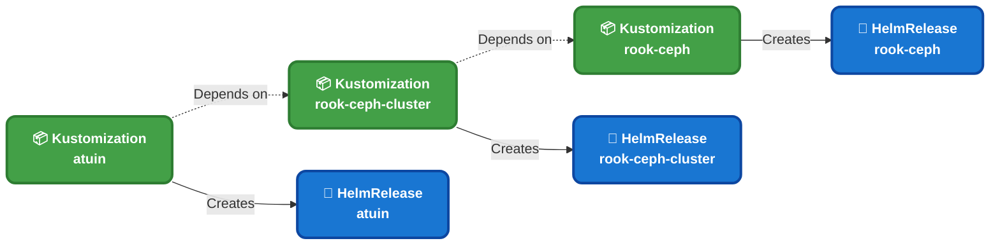

<div align="center">

### My _ever-evolving_ homelab 

_... managed with Flux, Renovate, and GitHub Actions_ 

</div>

---

##  Overview

This repository contains my homelab infrastructure and Kubernetes cluster, managed as code using GitOps principles. The setup leverages [Terraform](https://www.terraform.io/), [Kubernetes](https://kubernetes.io/), [Flux](https://github.com/fluxcd/flux2), [Renovate](https://github.com/renovatebot/renovate), and [GitHub Actions](https://github.com/features/actions) to maintain a fully automated, declarative environment.

##  Infrastructure

The homelab runs on a **Proxmox hypervisor**, which provides the virtualization foundation for all services:

- **Talos VM** - Hosts the Kubernetes control plane
- **Docker VM** - Pelican Game Servers

This hybrid approach maintains a clean, immutable Kubernetes environment while preserving flexibility for legacy applications and services that don't require Kubernetes orchestration.

##  Kubernetes

The cluster runs on [Talos Linux](https://github.com/siderolabs/talos) - an immutable, minimal operating system purpose-built for Kubernetes. It currently operates as a **single-node setup** on an [MS-A2](https://store.minisforum.com/products/minisforum-ms-a2) workstation running Proxmox, with workloads and block storage coexisting on the same hardware. [Rook](https://github.com/rook/rook) provides persistent storage within the cluster, while a separate ZFS server handles NFS/SMB shares, media storage, and backups.

The architecture is designed for future expansion - additional MS-A2 nodes can be added later to enable high availability and distributed storage.

If you’d like to build something similar, the [onedr0p/cluster-template](https://github.com/onedr0p/cluster-template) is a great place to start.

### Core Components

- [actions-runner-controller](https://github.com/actions/actions-runner-controller): Self-hosted GitHub runners for CI/CD workflows.
- [cert-manager](https://github.com/cert-manager/cert-manager): Automated SSL certificate management and provisioning.
- [cilium](https://github.com/cilium/cilium): High-performance container networking powered by [eBPF](https://ebpf.io).
- [cloudflared](https://github.com/cloudflare/cloudflared): Secure tunnel providing Cloudflare-protected access to cluster services.
- [envoy-gateway](https://github.com/envoyproxy/gateway): Modern ingress controller for cluster traffic management.
- [external-dns](https://github.com/kubernetes-sigs/external-dns): Automated DNS record synchronization for ingress resources.
- [external-secrets](https://github.com/external-secrets/external-secrets): Kubernetes secrets management integrated with [Bitwarden Secrets Manager](https://bitwarden.com/products/secrets-manager/).
- [rook](https://github.com/rook/rook): Cloud-native distributed storage orchestrator for persistent storage.
- [volsync](https://github.com/backube/volsync): Advanced backup and recovery solution for persistent volume claims.

### GitOps

In this setup, **Git is the single source of truth** for the cluster’s desired state.

[Flux](https://github.com/fluxcd/flux2) continuously monitors the contents of the [kubernetes](./kubernetes) directory and reconciles the cluster so it always matches what’s defined in the repository. It works by recursively scanning the [kubernetes/apps](./kubernetes/apps) folder, locating the top-level `kustomization.yaml` in each application directory. These top-level Kustomizations typically define a namespace and one or more Flux `Kustomization` resources (`ks.yaml`), each of which manages its own `HelmRelease` or other Kubernetes manifests.

Complementing this, [Renovate](https://github.com/renovatebot/renovate) scans the **entire** repository for dependency updates and automatically opens pull requests when new versions become available. Once a PR is merged, Flux detects the change and applies the updated configuration to the cluster, completing the GitOps loop.

---

### Directories

This Git repository contains the following directories under [Kubernetes](./kubernetes/).

```sh
📁 kubernetes     # Kubernetes cluster defined as code
├── 📁 apps       # Applications grouped by namespace
├── 📁 components # Re-useable kustomize components
└── 📁 flux       # Flux system configuration
```


### Cluster layout

Here's how Flux orchestrates application deployments with dependencies. Most applications are deployed as `HelmRelease` resources that depend on other `HelmRelease`'s, while some `Kustomization`'s depend on other `Kustomization`'s. Occasionally, an application may have dependencies on both types. The diagram below illustrates this: `atuin` won't deploy or upgrade until `rook-ceph-cluster` is successfully installed and healthy.

<details>
  <summary>Click to see a high-level architecture diagram</summary>


</details>

---

##  DNS

I use two separate [ExternalDNS](https://github.com/kubernetes-sigs/external-dns) deployments in my cluster to automate DNS management for both internal and external services:

* **Private DNS:** One instance syncs internal records to my UCG Fiber using the [ExternalDNS webhook provider for UniFi](https://github.com/kashalls/external-dns-unifi-webhook).
* **Public DNS:** A second instance manages public-facing records and syncs them to Cloudflare.

This separation is controlled through two dedicated gateways `internal` and `external`. Each ExternalDNS deployment watches only the routes associated with its respective gateway, ensuring that private records go to UniFi and public records go to Cloudflare.


---

##  Hardware


| Device                        | OS Disk         | Data Disk                   | RAM   | OS               | Purpose                 |
|-------------------------------|-----------------|-----------------------------|-------|------------------|-------------------------|
| MS-A2 (AMD Ryzen™ 9 9955HX)   | 1.92TB M.2      | 4TB M.2                     | 64GB  | Proxmox          | Hypervisor              |
| QNAP TS-464                   | 256TB M.2       | 3×8TB HDD + 1TB M.2         | 8GB   | TrueNAS SCALE CE | NFS Storage             |
| UniFi Cloud Gateway Fiber     | -               | -                           | -     | UniFi OS         | Router                  |
| UniFi Network Video Recorder  | -               | 1x6TB HDD                   | -     | UniFi OS         | NVR                     |
| APC BX1600MI Back-UPS         | -               | -                           | -     | -                | Backup Power            |

---

### MS-A2 Configuration

MS-A2 workstation is equipped with:

- [Crucial 64GB DDR5-5600 SODIMM](https://www.crucial.com/memory/ddr5/CT64G56C46S5) (RAM Shortage so i cannot buy another one 😔)
- [Samsung 4TB PCIe 4.0 NVMe™ M.2 SSD 990 PRO](https://www.samsung.com/us/computing/memory-storage/solid-state-drives/990-pro-pcie-4-0-nvme-ssd-4tb-mz-v9p4t0b-am/)
- [Sparkle Intel Arc A310 ECO 4GB GPU](https://www.sparkle.com.tw/en/products/view/f22F9bC73c50)

---

## ⭐ Credits

Huge thanks to the Home Operations community and especially [@JamesTurland](https://github.com/JamesTurland) for the inspiration and [@onedr0p](https://github.com/onedr0p) and [@buroa](https://github.com/buroa) for templates this setup is built upon.

If you're starting your own homelab journey, check out:

* [onedr0p/cluster-template](https://github.com/onedr0p/cluster-template)
* [kubesearch.dev](https://kubesearch.dev)
* [Home Operations Discord](https://discord.gg/home-operations)
